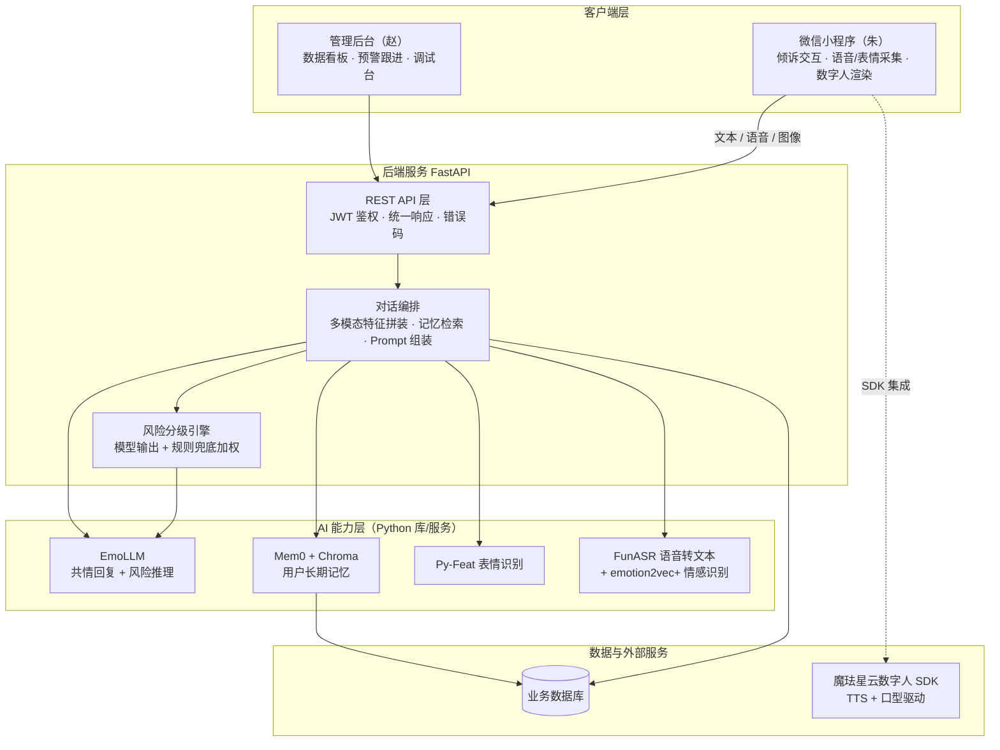
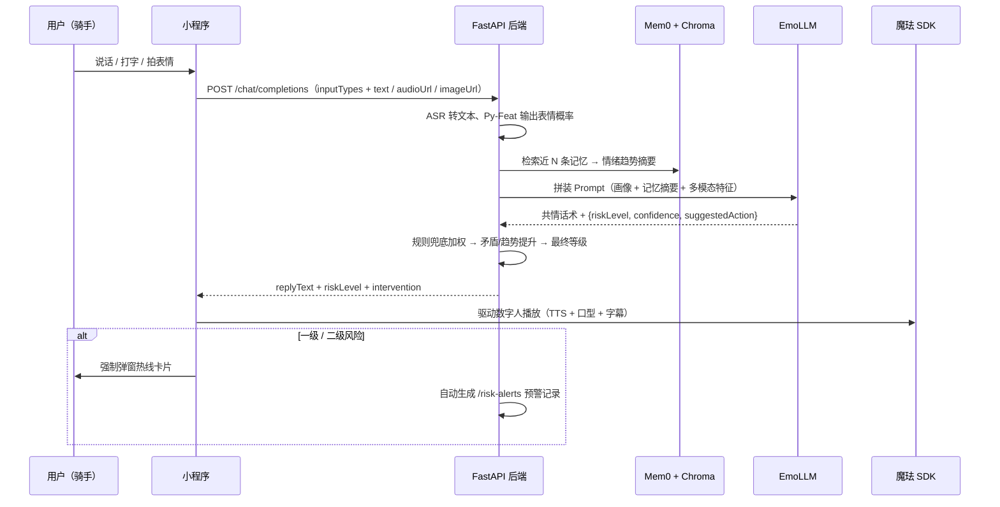
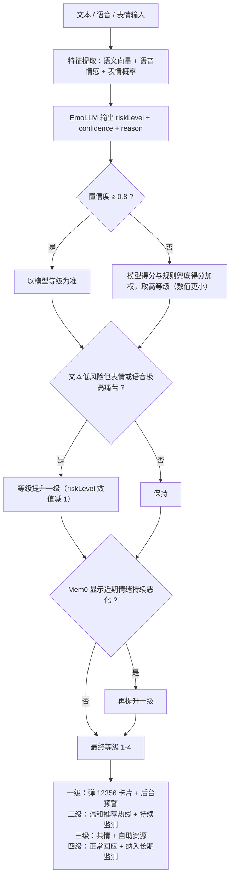

# 歇会儿 · 开发计划

> 本文档基于《歇会儿》PRD V6.3（最新修订版）整理，面向三名队员（朱-小程序端、赵-管理后台、后端-共同约定），作为开发期间的对照文件。文中标注「待确认」的条目需要在开工前碰一次，其他内容可以直接按顺序执行。

## 一、项目概览

一句话说清这个项目：给外卖骑手、快递员、网约车司机一个随时在线的"歇会儿"。他们被罚款、被差评、出了纠纷没处说，App 里的数字人会听他们讲、识别情绪、给共情回应；一旦识别到高危信号（比如说出轻生的话），立刻弹窗推送心理热线并通知后台人工跟进，走完"情绪识别 → 共情倾听 → 分级干预 → 高危转介"的完整闭环。

三个端的分工与职责边界：

| 端 | 负责人 | 技术栈 | 核心职责 |
| :--- | :--- | :--- | :--- |
| 小程序端 | 朱 | 微信小程序原生 + 魔珐星云 SDK | 用户侧全部交互：登录、选数字人、语音/图像采集、数字人展示、干预弹窗 |
| 管理后台 | 赵 | Vue3 + Element Plus | 运营侧：数据看板、预警跟进、调试台、RBAC 权限 |
| 后端与 AI 服务 | 共同（建议指定 1 名主责） | Python FastAPI + EmoLLM + Mem0 + Py-Feat + FunASR + emotion2vec+ | 业务接口、对话编排、记忆检索、风险分级、预警生成 |

后端是三端的交汇点，也是本次开发的关键路径。建议开工会上明确 1 名后端主责队员，另外两人在各自端的开发间隙支援联调，避免"共同负责"变成"无人负责"。

## 二、系统架构

先看整体结构，再解释每个部分为什么这么选。

架构上的几个要点：

- 小程序和管理后台不直接碰任何 AI 组件，所有智能逻辑收敛在后端。这样做的好处是风险分级逻辑（这是本项目的命脉）只有一份实现，调试台改阈值时只改后端，两端表现一致。
- Mem0 + Chroma 独立为记忆层：对话前检索"这个用户最近的情绪趋势"，对话后写入新记忆，这正是 PRD 九里"情绪持续恶化自动升级"的数据来源。
- 魔珐星云 SDK 只在小程序端集成（PRD 已定，自带 TTS 和口型驱动，省掉自研语音合成），后端只返回数字人需要播放的文本和动作指令。

技术选型与理由：

| 选型 | 为什么选它 |
| :--- | :--- |
| FastAPI | Mem0、Py-Feat 都是 Python 库，后端与 AI 层同语言，省掉跨语言胶水层；异步特性对流式回复友好 |
| SQLite 起步（可平滑换 MySQL） | PRD 未指定业务数据库。黑客松阶段用户量小，SQLite 零安装、单文件、Windows 上双击就能跑；表结构用 SQLAlchemy 写，后期要换库只改连接串（待确认） |
| EmoLLM | PRD 已定，心理健康领域开源模型，自带共情与风险识别的对话风格 |
| Chroma 向量库 | Mem0 官方支持列表里的主流选项，纯本地、无需起独立数据库服务，Windows 兼容好 |
| Py-Feat | PRD 已定，学术界常用的表情情绪识别库，输出悲伤/愤怒/恐惧等情绪概率 |
| FunASR + emotion2vec+ | PRD V6.3 统一。阿里 FunAudioLLM 原生同构生态，一套框架搞定语音转文字（FunASR）与语音情感大模型（emotion2vec_plus_base），直接输出悲伤/愤怒/恐惧/中性等离散情绪概率，与 Py-Feat 视觉情绪对齐 |
| JWT 鉴权 | PRD 8.1 已定，小程序与管理后台共用一套鉴权体系，后台按角色区分权限 |

## 三、开发路线

总体节奏三条原则：

1. **接口契约先行**。第 1 周先把 Apifox 上的接口清单按 PRD 8.2 / 8.3 定稿冻结，之后三端并行开发，互不等待。接口要改必须先在 Apifox 改完同步双方，这是 PRD 的协作红线。
2. **P0 闭环优先**。先跑通"登录 → 选数字人 → 完善信息 → 对话 → 分级干预"这条主线，P1（倾诉记录、我的、数据看板）排在其后。
3. **AI 分层集成**。对话接口第一版先直连云端大模型 API 把链路跑通（真实推理，不是假数据），再依次叠加 EmoLLM 替换、Mem0 记忆、Py-Feat 表情、风险分级规则。每层可独立验证，出问题时好定位。

> 周期假设：按 3 周（15 个工作日）排布，比赛实际日程不同的话，按比例压缩，但阶段顺序不变、阶段六（联调）不要砍。〔假设，需按比赛截止日确认〕

### 阶段总览

| 阶段 | 时间 | 目标 | 主责 |
| :--- | :--- | :--- | :--- |
| 一、开工准备 | 第 1 周 · 前 2 天 | 接口契约冻结、仓库与环境就绪 | 全员 |
| 二、后端骨架 | 第 1 周 · 后 3 天 | 业务接口全部可用，AI 先走云端 API | 后端主责 |
| 三、小程序 P0 | 第 2 周整周 | P0 界面全部完成并与后端联调 | 朱 |
| 四、AI 深水区 | 第 2~3 周 | EmoLLM、Mem0、Py-Feat、风险分级落地 | 后端主责 |
| 五、管理后台 | 第 2~3 周并行 | P0（预警、账号、干预配置）先行 | 赵 |
| 六、联调与演示 | 最后 3~4 天 | 完整闭环、性能、脱敏、演示彩排 | 全员 |

阶段三、四、五可以并行：小程序和后台都只依赖阶段二产出的接口，不依赖 AI 深水区的完成度。

### 阶段一：开工准备

三件事，做完即可进入开发：

1. **接口契约冻结**。在 Apifox 建项目，把 PRD 8.2 小程序端接口（含 V6.1 新增的 `/upload` 和 `POST /conversations`）、8.3 管理后台 11 个接口录入，统一响应格式和错误码按 PRD 8.1 执行。定稿后导出 Markdown 给两端留底。
2. **仓库与环境**。GitHub 建仓库，建议单仓库三个目录（`miniprogram/`、`admin/`、`backend/`），权限管理简单、演示时克隆一次就够。各自装好环境：微信开发者工具、Node.js（后台用）、Python 3.10+（后端用）、魔珐星云开放平台账号（提前申请，审核可能要等，越早越好）。
3. **AI 资源盘点**。确认两件事：演示机器有没有 GPU（决定 EmoLLM 走本地量化部署还是云端 API）；申请一个通用大模型 API Key 作为阶段二的过渡推理通道。

### 阶段二：后端骨架

目标是让小程序和后台"有接口可调"。具体做法：

- 按 `routers / services / models` 分层搭 FastAPI 项目，统一响应 `{code, message, data}` 和 JWT 中间件。**配置 CORS 中间件**，管理后台（Vue3 SPA）开发阶段需要跨域访问后端。
- 按 PRD 8.4 的 8 个数据模型建表（SQLAlchemy + SQLite）。注意 V6.2 新增字段：`User.updatedAt`、`Message.imageUrl`、`RiskAlert.updatedAt`。
- 优先实现这条顺序的接口：微信登录（`code2Session` 换 openid，需要小程序的 AppID）→ 初始化三件套（`init-status`、`digital-humans`、`profile`，注意 `profile` 统一用 PUT 幂等）→ **文件上传 `/upload`**（音频/图像统一走两步流程：先上传拿 URL，再传 URL 给业务接口）→ **创建会话 `POST /conversations`**（返回 `conversationId`）→ 对话接口 `chat/completions`（第一版直连云端大模型 API，返回结构严格按 PRD 的响应示例，注意请求体已改为 `inputTypes` 数组支持多模态组合）→ 倾诉记录与一键清除 → 热线与自助资源 → 预警上报。
- AI 调用封装成一个独立的 provider 模块，对外暴露统一的 `generate_reply()` 签名。后续阶段四把 EmoLLM 替换进来时，业务代码一行不动。

### 阶段三：小程序端 P0

页面与功能清单（按开发顺序）：

1. 微信一键授权登录。
2. 两步初始化：选数字人（卡片列表，调 `/digital-humans`）→ 完善信息（年龄、性别、职业四选项）。启动时按 `init-status` 的两个布尔值决定跳转到哪一步，PRD 五的状态机逻辑。
3. 主倾诉界面：数字人形象区 + 字幕 + 播放控制，输入栏支持三种方式——打字、按住说话（`RecorderManager` 录音）、拍表情（`camera` 组件抓一帧，不用做实时视频流，拍照方式简单且演示可控）。采集的音频与图像**先调 `/upload` 上传拿 URL，再随 `chat/completions` 请求传 URL**（PRD V6.2 统一的两步流程）。支持多模态组合输入：如用户说话时同时拍表情，`inputTypes` 传 `["audio", "image"]`。
4. 分级干预弹窗：一二级弹出热线卡片（拨打 12356 等），三四级走正常回应，热线条目调 `/hotlines`。
5. 魔珐 SDK 集成：数字人渲染、TTS 播放与口型同步，播放后端返回的 `replyText` 与 `digitalHumanAction`。

两个容易踩的坑提前说：录音和摄像头权限要在 `app.json` 声明，首次使用时触发授权弹窗；开发阶段在开发者工具里勾选"不校验合法域名"即可连本地后端，但正式演示要么准备 HTTPS 域名，要么现场同样用开发者工具演示。

### 阶段四：AI 深水区

这是项目的技术核心，按依赖顺序分四步走：

1. **EmoLLM 落位**。有 GPU 就本地量化部署（如 Ollama 方案），没有就先保留阶段二的云端 API，把 PRD 十的"共情回应、正常化表达、问题重构、行动建议"分层话术写成系统 Prompt，让过渡模型先按树洞人设说话。
2. **Mem0 + Chroma 记忆层**。对话结束写入记忆，对话开始检索近 N 条形成"情绪趋势摘要"拼进 Prompt。这一步做完，"嘴上每次都说没事、实际持续恶化"的场景才识别得出来。
3. **多模态**。语音处理采用 **FunASR + emotion2vec+** 组合（音频统一上传后端：FunASR 转文本，同时 emotion2vec+ 提取情绪概率分布，主选 `emotion2vec_plus_base`，输出悲伤、愤怒、恐惧、中性等情绪标签与置信度）。Py-Feat 接收小程序上传的表情图，输出情绪概率。两路情绪特征在后端统一对齐，重点处理 PRD 九里的矛盾场景：文本低风险但表情/语音极高痛苦时，自动提升一级（即 riskLevel 数值减 1，如 4→3）。备选方案：若语音大模型本地资源受限，可换用轻量版 `emotion2vec_plus_seed`，或降级为纯文本/表情模态。V6.2 的 `inputTypes` 组合输入使矛盾场景可在单次请求内完成判定。
4. **风险分级引擎**。严格按 PRD 9.2 的判定流程实现：模型输出 `{riskLevel, confidence, reason, suggestedAction}` → 置信度 ≥0.8 用模型结果，否则与规则兜底得分加权取高（数值更小的等级） → 矛盾提升、趋势提升（提升一级 = riskLevel 数值减 1） → 按最终 riskLevel 查 PRD 8.2 映射表组装 `intervention` 结构下发。`suggestedAction` 仅后端内部使用，不直接下发前端。官方关键词库不直接触发干预，只进 RAG 检索库和 Prompt few-shot。

### 阶段五：管理后台

按优先级排序做，时间不够就砍后面的：

| 顺序 | 模块 | 优先级 | 说明 |
| :--- | :--- | :--- | :--- |
| 1 | 管理员登录 + RBAC | P0 | 权限矩阵照 PRD 七抄，超管/运营两个角色做按钮级控制 |
| 2 | 预警记录 | P0 | 一二级预警列表、人工跟进状态更新，这是后台最核心的页面 |
| 3 | 后台账号管理 | P0 | 仅超管可见 |
| 4 | 调试台-转介干预配置 | P0 | 风险阈值、热线列表、话术模板 |
| 5 | 数据驾驶舱 | P1 | 日活、倾诉时长、情绪分布、预警数量四张图 |
| 6 | 用户管理 / 倾诉记录 | P1 | 全部脱敏展示 |
| 7 | 调试台-多模态调试 / 数字人配置 | P1 | 对接阶段四产出的接口 |

脱敏不放在页面上临时做，做在接口层：管理端所有查询接口出库前统一走一个脱敏函数（隐藏手机号中段、姓名打星号），这样不会漏。

### 阶段六：联调与演示

- 三端联调完整闭环：登录 → 初始化 → 三种方式倾诉 → 四级风险各触发一次对应干预 → 后台看到预警 → 更新跟进状态。
- 性能对照 PRD 十一：AI 首字回复 < 1.5 秒（不达标就启用 `/chat/stream` 流式接口，PRD 里已预留）、语音合成延迟 < 1 秒。
- 隐私三验证：传输走 HTTPS、后台展示全脱敏、小程序一键清除后数据库和向量库同步删干净（记忆也要删）。
- 演示彩排：准备 2~3 条固定演示话术（日常吐槽走四级/焦虑走三级/崩溃表述走二级弹窗），提前用调试台把阈值调稳定，避免现场误判。

## 四、核心流程设计

### 对话主流程

用户发一句话之后，系统内部发生这些事：

关键设计：ASR 和 Py-Feat 都收进后端而不是放在小程序端做，小程序只负责采集原始数据。这样多模态的版本升级、参数调整都在后端一处完成，调试台改配置立即对两端生效。

### 风险分级判定流程

这是 PRD 九的核心逻辑，后端实现时照此图执行：

规则兜底只在模型不可用或置信度极低时启用关键词匹配降级，这是 PRD 9.4 的明确要求，也是防止漏报的安全网。

## 五、待团队确认的工程决策

开工会上过一遍这张表：

| 决策点 | 建议 | 为什么需要定 |
| :--- | :--- | :--- |
| 后端主责人 | 指定 1 名队员 | PRD 写"共同约定"，不定人则进度无人兜底 |
| EmoLLM 部署方式 | 有 GPU 本地量化部署；无 GPU 演示期用云端 API 过渡 | 决定阶段四的工作量和演示效果 |
| 语音多模态方案 | FunASR（语音转文字） + emotion2vec+（语音情感大模型，主选 base 版） | PRD V6.3 已统一为阿里开源语音体系，替代原 librosa 韵律方案，输出细粒度情绪分布 |
| 业务数据库 | SQLite 起步 | PRD 未指定，确认后不可中途反复 |
| 演示环境 | 云主机 + HTTPS 域名，或现场用开发者工具直连局域网后端 | 小程序正式包强制校验 HTTPS 域名 |
| 流式回复 | P0 先非流式，性能不达标再开 `/chat/stream` | PRD 标注为可选，避免一上来把复杂度做满 |

## 六、风险与应对

| 风险 | 影响 | 应对 |
| :--- | :--- | :--- |
| EmoLLM 本地部署门槛高（模型大、需要 GPU） | 阶段四延期 | 双路径：云端 API 过渡保闭环，GPU 就绪再切换；切换成本被 provider 封装压到一天内 |
| 魔珐 SDK 集成受阻（授权、文档、小程序兼容性） | 小程序端最显性的功能不可用 | 第一周就跑通官方 demo 验证可行性；备选方案：SDK 不可用时退化为静态形象图 + TTS 音频播放，保住"语音+字幕"体验 |
| 多模态识别准确率不稳定 | 演示现场误判风险等级 | 调试台提前调好阈值并锁定；演示话术提前跑通固定路径 |
| 三端进度不同步 | 联调期挤成一团 | 接口契约第一周冻结；每天 10 分钟站会对齐接口变更 |
| 隐私处理流于形式（黑客松常见） | 比赛评审扣分项 | 脱敏做在接口层、一键清除覆盖向量库，列入阶段六验收 |
| 高危误判漏报 | 产品底线问题 | 规则引擎兜底永远在线；置信度低时宁可升级不可放行 |

## 七、验收标准

对照 PRD 的最终检查，全部通过即达到交付状态：

**小程序端**
- 两步初始化按状态正确跳转，二次登录直达主界面
- 文字、语音、表情三种输入方式全部可用，数字人语音回复带口型和字幕
- 一二级触发强制热线弹窗，三级附自助资源，四级正常回应
- 倾诉记录可查、一键清除后数据不可再查（含记忆）

**后端与 AI**
- 风险分级引擎四档逻辑与 PRD 9.2 / 9.3 一致，矛盾提升和趋势提升两条规则生效
- 高危自动生成预警记录，后台可见
- 首字回复 < 1.5 秒，语音合成 < 1 秒

**管理后台**
- 超管/运营权限矩阵与 PRD 七逐格一致（运营看不到调试台和账号管理）
- 预警跟进状态可流转
- 所有用户数据脱敏展示

**演示**
- 一条 3 分钟内的完整演示路径：骑手倾诉被罚款 → 数字人共情 → 升级到崩溃表述 → 热线弹窗 → 后台预警出现 → 运营标记跟进
